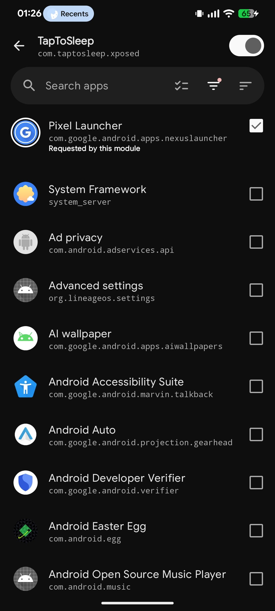
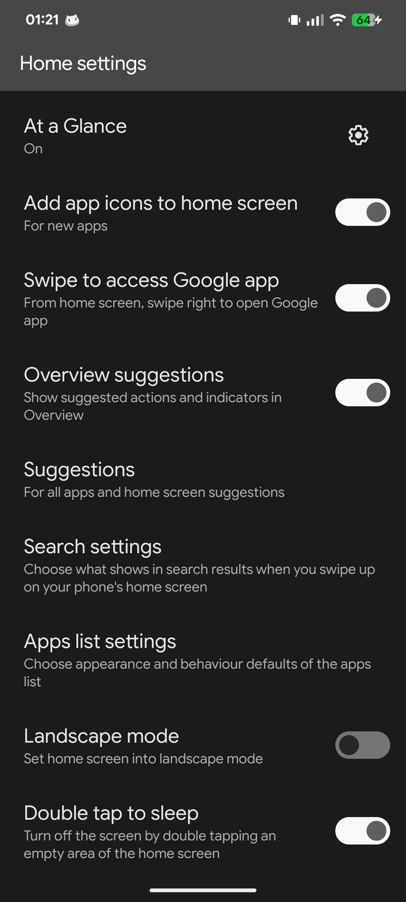

# TapToSleep

**Simple double tap to sleep for the Pixel Launcher. (A16 and below)**
An LSPosed module that adds **Double tap to sleep** toggle to the Pixel Launcher's Home settings. 
As the name suggests, double tap anywhere on an **empty** area of your home screen and the screen turns off.
And yes, it's just that. A simple module.

**Tested on Android 16 (QPR2)** (Pixel Launcher, `com.google.android.apps.nexuslauncher`, build `NexusLauncherRelease.apk` v16/versionCode 907).
Should work on **Android 15's Pixel Launcher** and **below** too. (Make an issue on Github if you found a launcher that is not supported, I will try my best to fix it)

| LSPosed Manager | Home settings toggle |
| --- | --- |
|  |  |

## Requirements

- Android 16/15/14 with the **stock Pixel Launcher** (Preferably on AOSP-based roms, not tested on InfinityX Launcher, Trebuchet or similar custom launchers).
- [LSPosed](https://github.com/LSPosed/LSPosed) (Zygisk or Riru) or it's **forks/modern implimentations** such as [Vector](https://github.com/JingMatrix/Vector)
- Root. The launcher itself has no `android.permission.DEVICE_POWER` so the module falls back to `su -c input keyevent 26` to turn the screen off.

## Installation

1. Download `DoubleTapToSleep.apk` from the latest release and install it:
2. Open **LSPosed Manager → Modules** and enable **TapToSleep**.
3. Scope it to **Pixel Launcher** (`com.google.android.apps.nexuslauncher`), this is the module's recommended app so LSPosed should select it by default.
4. Force-stop the Pixel Launcher so the patch applies, or reboot.

The module has 0 launcher icon or it's own UI, everything lives inside the launcher.

## Usage

1. Open the launcher's **Home settings** by long press an empty area of the home screen
2. Scroll down, you should see the **Double tap to sleep** option appears at the bottom of the list. Turn it on.
3. Try double tap any empty spot on the home screen.
**Note:** Double tapping an **icon**, **folder** or **widget** does nothing, and same for while a folder is open, during applist or in home edit mode.

## Building from source

Build with `aapt2` + `javac` + `d8` + `apksigner`, no Gradle needed.
Xposed API jar: de.robv.android.xposed:api:82 available from https://api.xposed.info/

```sh
export XPOSED_API_JAR=/path/to/api-82.jar
export ANDROID_SDK_ROOT=$HOME/Android/Sdk
./build.sh
```

The output is `DoubleTapToSleep.apk` zipaligned with `resources.arsc` stored uncompressed as Android 11+ format.

## License

Free. Open-source. MIT. 
